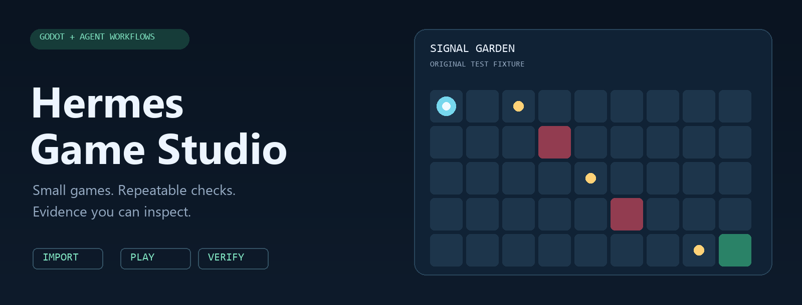

<p align="center">
  
</p>

<p align="center">
  <a href="https://github.com/lEWFkRAD/hermes-game-studio/actions/workflows/verify.yml"></a>
  
  
  <a href="LICENSE"></a>
</p>

<p align="center"><b>A tiny, evidence-first workbench for agent-assisted game development.</b><br>
One original game. A reusable skill. A check you can run again.</p>

---

Hermes Game Studio helps an agent take a small Godot game through **import → gameplay checks → scene boot**, then leave a readable receipt. It is an independent community prototype inspired by [Teknium's DIY game studio idea](https://x.com/teknium/status/2112092888821842088), ready to adapt as that work develops.

### What's in the box

| Piece | What it does |
| :--- | :--- |
| **Signal Garden** | An original, playable grid game with collection, hazards, an exit, and restart. No external art assets. |
| **`game-dev-verify`** | A portable skill for Hermes and compatible agents, with a practical game-development handoff workflow. |
| **`studio.py`** | A dependency-free Python runner that creates an isolated candidate, runs Godot, preserves logs, and writes a JSON receipt. |
| **Failure-aware checks** | Script errors, nonzero exits, timeouts, and missing or misleading success markers are treated as failures. |

### Run the workbench

Install **Python 3.11+** and a **Godot 4 editor binary**. The current engine validation used **Godot 4.7.1 on Windows**; other versions and platforms need their own engine run.

```bash
git clone https://github.com/lEWFkRAD/hermes-game-studio.git
cd hermes-game-studio

python skills/game-dev-verify/scripts/studio.py doctor --godot /path/to/godot
python skills/game-dev-verify/scripts/studio.py check --godot /path/to/godot --output artifacts
```

On Windows, replace `python` with `py -3.14` if appropriate and quote the executable path:

```powershell
py -3.14 -B skills/game-dev-verify/scripts/studio.py check --godot "C:/Tools/Godot/Godot_console.exe" --output artifacts
```

If `godot` is on PATH, omit `--godot`. You can also set `GODOT_BIN`.

Each check creates a fresh `artifacts/<run-id>/` with a project copy, separate logs, and `receipt.json`. Exit codes: **0** passed, **1** checks failed, **2** a prerequisite or output-location check blocked the run. Existing runs are preserved. The runner executes only the bundled fixture; it does not verify arbitrary game directories.

### Play Signal Garden

Open `skills/game-dev-verify/assets/signal-garden/project.godot` in Godot and press **F6** on `main.tscn`, or run the project with **F5**.

| Input | Action |
| :--- | :--- |
| Arrow keys | Move one tile |
| Gold cells | Collect all three |
| Red tiles | Lose the round |
| Green exit | Win after collecting every cell |
| R | Restart with a clean state |

The header illustration represents the fixture; it is not a captured gameplay frame. The game intentionally uses simple procedural shapes so the workflow can be reproduced without an asset pipeline.

### Use the skill

Copy the complete [`skills/game-dev-verify`](skills/game-dev-verify) folder into the intended agent's skill library. For Hermes, use your active profile's `skills/` directory. For Codex, use `$CODEX_HOME/skills/` or `~/.codex/skills/`. Keep `scripts/`, `assets/`, `references/`, and `LICENSE` together. Inspect any existing same-named skill before replacing it.

Then ask the agent:

> Use game-dev-verify to check the bundled Signal Garden fixture. Show the receipt and distinguish automated checks from remaining playtest work.

This prototype needs no new MCP server, model provider, or background service. Native Hermes skill loading was verified locally; a complete model-driven game-building session remains unverified.

### What a pass means

| Gate | Current evidence |
| :--- | :--- |
| Engine import | Passed locally on Godot 4.7.1 / Windows |
| Gameplay logic | 12 assertions: fresh state, boundaries, collection, loss, win, and restart |
| Main scene boot | Passed headlessly |
| Verifier behavior | 7 Python tests; CI runs these on Windows and Linux |
| Rendered appearance / physical input | Separate manual acceptance; not certified by this suite |
| Frame times / native export / other engine platforms | Not yet qualified |

The CI badge covers the Python verifier tests, **not Godot execution**. Read the [validation notes](docs/VALIDATION.md) for exact scope. Runtime receipts contain local paths and environment details; review them before sharing.

### Shape of the repo

```text
skills/game-dev-verify/
  SKILL.md                  Agent entry point
  scripts/studio.py         Bounded verification runner
  assets/signal-garden/     Original Godot fixture + gameplay assertions
  references/workflow.md    Asset, playtest, and handoff gates
tests/test_runner.py        Verifier failure-path tests
docs/                      Validation notes and visual identity
```

### Help build it

Start with [CONTRIBUTING.md](CONTRIBUTING.md) and the [small roadmap](ROADMAP.md). Good first additions are a reproducible engine CI job, rendered/input acceptance, or one focused asset-validation check. Keep changes small enough to demonstrate with real evidence.

Built with Codex assistance. Original kit code and procedural fixture: [MIT](LICENSE). Godot and Hermes retain their own licenses and trademarks. This project is not an official Nous Research product.
