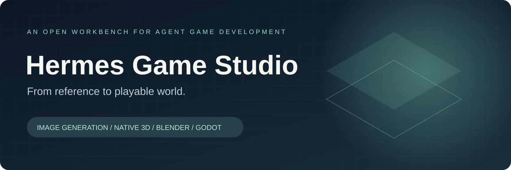

<p align="center"></p>
<p align="center">
<a href="https://github.com/lEWFkRAD/hermes-game-studio/actions/workflows/verify.yml"></a>


<a href="LICENSE"></a>
</p>

<p align="center"><b>A working collection of tools for agent-assisted game creation.</b><br>Generate references. Build meshes. Inspect the actual asset. Verify the game.</p>

---

This repository brings together the reusable parts of our existing game-development stack: **Mac image generation, native TRELLIS.2, durable mesh jobs, Blender preparation and review, and Godot verification**. It is an independent community project inspired by [Teknium’s DIY game studio direction](https://x.com/teknium/status/2112092888821842088).

The first release only exposed a small Godot fixture. This expanded edition recovers the asset pipeline built across NeonGrid and the subsequent native Metal experiments. These are separately usable components; a single automated end-to-end studio is still being qualified.

### The workbench

| Stage | Included tools | What you get |
| :--- | :--- | :--- |
| **Reference & audio** | [Mac queue + MCP](pipelines/mac-auxiliary/README.md) | SDXL text/image-to-image workflows, instrumental music adapter, stable request IDs, owned processes and resource admission. |
| **Native 3D** | [Native Metal pipeline](pipelines/native-metal/README.md) | Pinned Q8 weights, 1024 geometry/PBR profile, immutable job packages, guarded launch, saved-dump inspection and replay/export extension. |
| **Durable mesh jobs** | [Photo-to-mesh client](pipelines/photo-mesh/README.md) | One explicit submit, GET-only reconnection, hash-bound recovery, resumable artifact collection. |
| **Asset finishing** | [Blender toolkit](pipelines/blender/README.md) | Editable `.blend` + GLB preparation, topology audit, original-material and clay review, persistent review jobs and MCP tools. |
| **Game verification** | [Godot workbench](docs/GODOT.md) | Original Signal Garden fixture, reusable agent skill, import/gameplay/boot checks and receipts. |

### Start without a model

Python 3.11+ is sufficient for all offline tests. No model downloads, backend calls or Blender installation are required:

```bash
git clone https://github.com/lEWFkRAD/hermes-game-studio.git
cd hermes-game-studio
python -B scripts/check.py
```

Then choose a stage above. Each has its own prerequisites and explicit setup. Model binaries, weights, backend servers and optional MCP dependencies are installed separately. Example Mac workloads are disabled until configured; nothing is registered or started by cloning or testing this repo.

To try the bundled game with a Godot 4 editor:

```bash
python skills/game-dev-verify/scripts/studio.py check --godot /path/to/godot --output artifacts
```

### Build with evidence

1. Record a brief, source/reference rights, scale, axes and the intended game camera.
2. Submit one bounded generation job. Keep its request ID, input hash and settings.
3. Recover an interrupted connection from the existing job; preserve uncertain submissions.
4. Inspect geometry and PBR data, export a candidate, and review it in Blender.
5. Do the required retopology, materials, rigging and animation work. A generated mesh is a candidate, not an accepted character.
6. Import into the game, inspect the actual rendered result, then check gameplay, performance and export separately.

See [workflow and handoff](docs/WORKFLOW.md), [validation scope](docs/VALIDATION.md), and the [recovery manifest](docs/RECOVERY.json). Local runtime receipts are ignored by Git.

### Evidence and boundaries

The portable Python suites cover queue limits, duplicate prevention, ambiguous submissions, artifact recovery, native package integrity, malformed dump rejection, Blender review recovery and engine-runner failures. CI runs these offline checks on Windows and Linux; it does **not** run Mac inference, Blender rendering or Godot.

The original stack has recorded native Metal generation, textured GLB export and Blender review runs. Those are historical evidence. The extracted Mac launcher and replay builder need a fresh target-machine qualification; their binary hashes deliberately describe the recorded build, not every future rebuild. [Details →](docs/VALIDATION.md)

Project-specific character assembly, rigging/LOD recipes, old FLUX staging scripts, game assets and model weights are outside this extraction. [The roadmap](ROADMAP.md) distinguishes existing work awaiting extraction from capabilities still needing implementation or qualification.

### Contribute

Start with [CONTRIBUTING.md](CONTRIBUTING.md). The most useful next contribution is a reproducible vertical slice with an original asset and visible acceptance evidence. Upstream alignment is tracked in [CONTRIBUTION.md](CONTRIBUTION.md); this repo is not an official Hermes integration.

Our code is MIT. The replay extension retains the [upstream TRELLIS notice](pipelines/native-metal/LICENSE.trellis.cpp). Model weights, backend software and generated assets have their own terms; this repository does not redistribute them.
